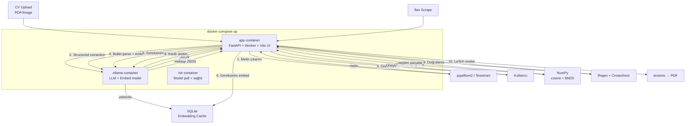
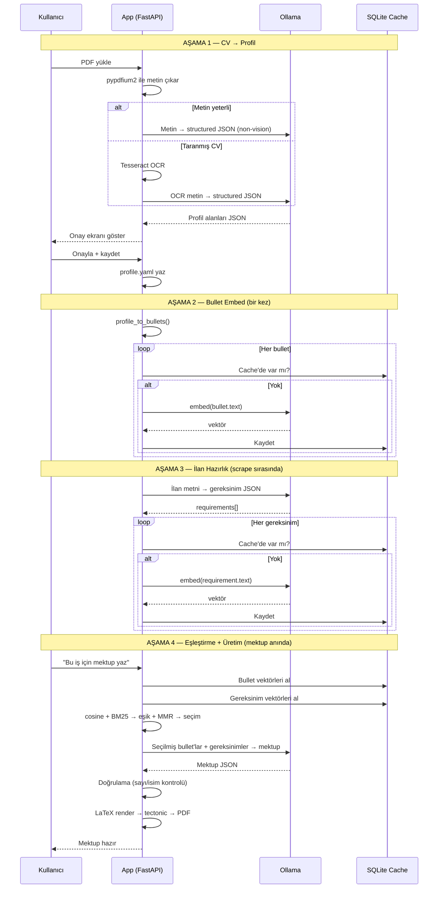

# JobScout v2 — Yerel-Öncelikli Mimari Planı

> CV → Profil → Embedding Cache → İlan Eşleştirme → Kısıtlı Mektup Üretimi
>
> Hedef: `docker compose up` ile her şey ayağa kalksın, tüm veri ve model yerelde kalsın.

---

## Mevcut Durum Özeti

Projeyi baştan sona inceledim. İşte şu an var olan yapı:

| Katman | Durum | Dosya |
|--------|-------|-------|
| CV okuma | Vision model (NVIDIA API) ile rasterize → JSON | [`cv_import.py`](file:///Volumes/2TBSSD/anilexternal/Documents/multi-agents/jobscout/cover_letter/cv_import.py) |
| Profil | Pydantic model, YAML I/O, readiness check | [`profile.py`](file:///Volumes/2TBSSD/anilexternal/Documents/multi-agents/jobscout/cover_letter/profile.py) |
| İlan scrape | LinkedIn + Indeed (Playwright), cached fixtures | [`sources/`](file:///Volumes/2TBSSD/anilexternal/Documents/multi-agents/jobscout/sources) |
| Mektup üretimi | Tüm profil + tüm ilan → LLM → JSON → LaTeX | [`llm.py`](file:///Volumes/2TBSSD/anilexternal/Documents/multi-agents/jobscout/cover_letter/llm.py), [`generator.py`](file:///Volumes/2TBSSD/anilexternal/Documents/multi-agents/jobscout/cover_letter/generator.py) |
| Şablon | DIN 5008 Jinja2 → LaTeX → tectonic PDF | [`cover_letter.tex.j2`](file:///Volumes/2TBSSD/anilexternal/Documents/multi-agents/templates/cover_letter.tex.j2) |
| API | FastAPI + SSE + Vite React UI | [`server.py`](file:///Volumes/2TBSSD/anilexternal/Documents/multi-agents/jobscout/ui/server.py) |
| Config | NVIDIA NIM, `profile.yaml`, `.env` | [`config.py`](file:///Volumes/2TBSSD/anilexternal/Documents/multi-agents/jobscout/config.py) |

### Eksikler (senin planında da var olanlar)

1. **Embedding yok** — mektup üretiminde profil ve ilan bütünüyle LLM'e gönderiliyor, seçim yok
2. **Parça seçimi yok** — tüm deneyim, tüm skills, tüm cv_text prompt'a giriyor
3. **İlan yapılandırması yok** — ham HTML/text olarak gönderiliyor
4. **Yerel model desteği yok** — NVIDIA NIM API'ye bağımlı
5. **Docker yok** — tamamen lokal geliştirme ortamı
6. **Doğrulama yok** — mektupta uydurma kontrolü yapılmıyor

---

## BÖLÜM 1 — Hedef Mimari



---

## BÖLÜM 2 — Docker Compose Tasarımı

```yaml
# docker-compose.yml
services:
  ollama:
    image: ollama/ollama:latest
    ports:
      - "11434:11434"
    volumes:
      - ollama_models:/root/.ollama
    deploy:
      resources:
        reservations:
          memory: 4G

  init:
    image: ollama/ollama:latest
    depends_on:
      ollama:
        condition: service_started
    entrypoint: ["/bin/sh", "-c"]
    command:
      - |
        until curl -sf http://ollama:11434/api/tags; do sleep 1; done
        ollama pull qwen2.5:7b
        ollama pull bge-m3
        echo "Models ready"
    environment:
      OLLAMA_HOST: http://ollama:11434

  app:
    build: .
    ports:
      - "8000:8000"
      - "3001:3001"
    depends_on:
      init:
        condition: service_completed_successfully
    volumes:
      - ./config:/app/config
      - ./data:/app/data
      - ./templates:/app/templates
    environment:
      OLLAMA_URL: http://ollama:11434
      LLM_MODEL: qwen2.5:7b
      EMBED_MODEL: bge-m3
      COVER_LETTER_BASE_URL: http://ollama:11434/v1
      COVER_LETTER_API_KEY: ollama

volumes:
  ollama_models:
```

### GPU Override

```yaml
# docker-compose.gpu.yml
services:
  ollama:
    deploy:
      resources:
        reservations:
          devices:
            - driver: nvidia
              count: 1
              capabilities: [gpu]
```

```bash
# GPU'lu başlatma
docker compose -f docker-compose.yml -f docker-compose.gpu.yml up
```

### Host Ollama Kullanımı

```bash
# Zaten Ollama çalıştıranlar:
OLLAMA_URL=http://host.docker.internal:11434 docker compose up app
```

---

## BÖLÜM 3 — Model Profilleri

| Profil | LLM | Embed | RAM | GPU |
|--------|-----|-------|-----|-----|
| **light** | `gemma3:4b` | `bge-m3` | ~6 GB | Opsiyonel |
| **balanced** | `qwen2.5:7b` | `bge-m3` | ~8 GB | Önerilir |
| **quality** | `qwen2.5:14b` | `bge-m3` | ~12 GB | Gerekli |

> [!IMPORTANT]
> Varsayılan `balanced` olmalı. `num_ctx` her çağrıda açıkça ayarlanmalı — Ollama'nın varsayılanı 2048 ile uzun CV/ilan kesilir.

---

## BÖLÜM 4 — Veri Modeli Değişiklikleri

### 4.1 Profil: Bullet-Seviyesi Başarı Bankası

Mevcut [profile.yaml](file:///Volumes/2TBSSD/anilexternal/Documents/multi-agents/config/profile.yaml) yapısı deneyim→achievements olarak iç içe. Bunu **bozmadan** bullet seviyesinde indeksleme yapacağız:

```python
# jobscout/cover_letter/bullets.py (YENİ)

@dataclass
class Bullet:
    """Tek bir başarı maddesi, metadata ile."""
    id: str                    # "exp-0-ach-2" veya uuid
    text: str                  # madde metni
    company: str
    role: str
    start: str
    end: str
    location: str
    tags: list[str]            # otomatik çıkarılan yetenekler
    language: str              # "de" | "en"
    source: str                # "experience" | "education" | "certification"

def profile_to_bullets(profile: Profile) -> list[Bullet]:
    """Profildeki her achievements maddesini ayrı Bullet'a çevir."""
    bullets = []
    for i, exp in enumerate(profile.experience):
        for j, ach in enumerate(exp.achievements):
            bullets.append(Bullet(
                id=f"exp-{i}-ach-{j}",
                text=ach,
                company=exp.company,
                role=exp.role,
                start=exp.start,
                end=exp.end,
                location=exp.location,
                tags=_extract_tags(ach),  # basit keyword extraction
                language=_detect_lang(ach),
                source="experience",
            ))
    # Eğitim, sertifikalar da eklenebilir
    ...
    return bullets
```

### 4.2 Embedding Cache: SQLite

```python
# jobscout/cover_letter/embedding_cache.py (YENİ)

class EmbeddingCache:
    """
    Cache key: (content_hash, model_name)
    Bullet veya gereksinim metni değişmediği sürece embedding tekrar hesaplanmaz.
    """
    def __init__(self, db_path: Path):
        self.db = sqlite3.connect(db_path)
        self._create_table()

    def get(self, text: str, model: str) -> np.ndarray | None: ...
    def put(self, text: str, model: str, vector: np.ndarray) -> None: ...
    def get_or_compute(self, text: str, model: str,
                       embed_fn: Callable) -> np.ndarray: ...
```

### 4.3 İlan Gereksinimleri

```python
# jobscout/cover_letter/requirements.py (YENİ)

@dataclass
class JobRequirement:
    """İlandan çıkarılmış tek bir gereksinim."""
    id: str
    text: str
    category: str   # "must_have" | "nice_to_have" | "responsibility"
    keywords: list[str]

def extract_requirements(description: str, llm_client) -> list[JobRequirement]:
    """LLM ile ilandan boilerplate temizle, gereksinimleri JSON olarak çıkar."""
    # Structured output ile
    ...
```

---

## BÖLÜM 5 — Yeni Modüller (Dosya Haritası)

Mevcut yapıya eklenecek dosyalar:

```
jobscout/cover_letter/
├── __init__.py          ← güncelle: yeni export'lar
├── bullets.py           ★ YENİ: Profil → bullet dönüşümü
├── cv_import.py         ← güncelle: metin-öncelikli fallback
├── description.py       ← mevcut
├── embedding_cache.py   ★ YENİ: SQLite embedding cache
├── embedder.py          ★ YENİ: Ollama embedding istemcisi
├── generator.py         ← güncelle: matcher entegrasyonu
├── latex.py             ← mevcut
├── llm.py               ← güncelle: Ollama uyumlu
├── matcher.py           ★ YENİ: Hibrit eşleştirme motoru
├── profile.py           ← mevcut
├── requirements.py      ★ YENİ: İlan gereksinim çıkarımı
└── verifier.py          ★ YENİ: Mektup doğrulama
```

```
config/
├── profile.yaml         ← mevcut
├── profile.example.yaml ← güncelle: bullet örnekleri
└── search.yaml          ← mevcut

docker-compose.yml       ★ YENİ
docker-compose.gpu.yml   ★ YENİ
Dockerfile               ★ YENİ

eval/                    ★ YENİ: Değerlendirme seti
├── pairs.json           # 15-20 CV/ilan çifti, insan etiketli
└── run_eval.py          # recall@k ölçümü
```

---

## BÖLÜM 6 — CV Okuma: Metin Öncelikli Akış

Mevcut [cv_import.py](file:///Volumes/2TBSSD/anilexternal/Documents/multi-agents/jobscout/cover_letter/cv_import.py) her şeyi vision modele gönderiyor. Yerelde bu çok ağır. Yeni akış:

```
PDF yüklendi
    │
    ▼
pypdfium2 / pymupdf4llm ile metin çıkar
    │
    ├── Sayfa başı ≥200 karakter? ──► EVET → Metin var, vision'a gerek yok
    │                                          │
    │                                          ▼
    │                                   Ollama LLM + structured output
    │                                   (JSON schema ile, vision değil)
    │
    └── HAYIR (taranmış CV) ──► Tesseract / RapidOCR
                                     │
                                     ├── OCR başarılı? → LLM çıkarım
                                     └── Başarısız → Elle doldurma formu
```

> [!TIP]
> **Vision modeli en son çare.** CPU'da vision modeli çalıştırmak 2-5 dakika sürer. Metin → LLM ile 15-30 saniyeye düşer. Çoğu modern CV zaten metin katmanlı PDF.

### Mevcut `cv_import.py`'deki Değişiklik

```diff
 def import_cv_into_profile(
     profile: Profile,
     data: bytes,
     filename: str,
     ...
 ) -> Profile:
+    # Aşama 1: Metin çıkarımı dene
+    text = extract_text_from_pdf(data)
+    if text and len(text) >= 200:
+        # Metin yeterli, LLM ile structured extraction
+        extracted = llm_extract_from_text(text, base_url, api_key, model)
+        return merge_into_profile(profile, extracted)
+
+    # Aşama 2: OCR dene
+    ocr_text = try_ocr(data)
+    if ocr_text and len(ocr_text) >= 200:
+        extracted = llm_extract_from_text(ocr_text, ...)
+        return merge_into_profile(profile, extracted)
+
+    # Aşama 3: Vision fallback (opsiyonel, sadece vision model varsa)
     if pages is None:
         pages = images_from_upload(data, filename, ...)
     ...
```

---

## BÖLÜM 7 — Embedding + Eşleştirme Motoru

### 7.1 Embedder (Ollama)

```python
# jobscout/cover_letter/embedder.py

class OllamaEmbedder:
    """Ollama /v1/embeddings endpoint'i ile çalışır."""

    def __init__(self, base_url: str, model: str = "bge-m3"):
        self.base_url = base_url.rstrip("/")
        self.model = model

    def embed(self, texts: list[str]) -> np.ndarray:
        """Batch embedding. Ollama tek seferde birden fazla metin destekler."""
        response = httpx.post(
            f"{self.base_url}/v1/embeddings",
            json={"model": self.model, "input": texts},
            timeout=120.0,
        )
        response.raise_for_status()
        data = response.json()
        vectors = [item["embedding"] for item in data["data"]]
        return np.array(vectors, dtype=np.float32)
```

### 7.2 Hibrit Matcher

```python
# jobscout/cover_letter/matcher.py

@dataclass
class Match:
    bullet: Bullet
    score: float
    semantic_score: float
    keyword_score: float
    matched_requirement: str

class HybridMatcher:
    """
    Embedding benzerliği + anahtar kelime örtüşmesi.
    Küçük modellere seçim işi bırakmıyoruz — bu kısım deterministik.
    """

    def __init__(
        self,
        embedder: OllamaEmbedder,
        cache: EmbeddingCache,
        semantic_weight: float = 0.7,
        keyword_weight: float = 0.3,
        threshold: float = 0.25,
        max_matches: int = 8,
    ): ...

    def match(
        self,
        bullets: list[Bullet],
        requirements: list[JobRequirement],
    ) -> list[Match]:
        """
        Her gereksinim için en iyi bullet'ları bul (coverage mantığı).
        Sonra eşik + MMR + üst sınır uygula.
        """
        # 1. Bullet embedding'leri cache'den al veya hesapla
        bullet_vectors = self._get_vectors(bullets)
        req_vectors = self._get_vectors(requirements)

        # 2. Cosine similarity matrix: (n_req × n_bullet)
        sim_matrix = cosine_similarity(req_vectors, bullet_vectors)

        # 3. Keyword/BM25 overlap bonus
        keyword_matrix = self._keyword_overlap(bullets, requirements)

        # 4. Hibrit skor
        scores = (
            self.semantic_weight * sim_matrix +
            self.keyword_weight * keyword_matrix
        )

        # 5. Coverage: her gereksinim için en iyi bullet
        selected = self._coverage_select(scores, bullets, requirements)

        # 6. MMR ile çeşitlilik sağla
        selected = self._mmr_rerank(selected, bullet_vectors)

        # 7. Eşik uygula
        selected = [m for m in selected if m.score >= self.threshold]

        # 8. Her zaman dahil et: en güncel pozisyon
        selected = self._ensure_recent(selected, bullets)

        return selected[:self.max_matches]
```

### Neden BM25 / Keyword Ekliyoruz?

> [!IMPORTANT]
> "FastAPI", "PostgreSQL", "Kubernetes" gibi teknik terimler embedding'de bazen benzer skora sahip olur (ikisi de backend). Ama ilanda "FastAPI deneyimi şart" yazıyorsa, keyword eşleşmesi bunu kesin yakalıyor. Hibrit skor her ikisinin güçlü yanını birleştirir.

---

## BÖLÜM 8 — Mektup Üretimi: Kısıtlı Yazım

Mevcut [`llm.py`](file:///Volumes/2TBSSD/anilexternal/Documents/multi-agents/jobscout/cover_letter/llm.py) tüm profili prompt'a gönderiyor (satır 121-126). Yeni akış:

```
Tüm profil yerine → Seçilmiş bullet'lar (ID'li) + kimlik bilgileri
```

### Prompt Değişikliği

```diff
 user_prompt = (
-    "Applicant profile (YAML):\n"
-    f"{profile.prompt_text()}\n\n"
-    "Job posting:\n"
-    f"{job_text}\n\n"
+    "Applicant identity:\n"
+    f"Name: {profile.name}\n"
+    f"Headline: {profile.headline}\n"
+    f"City: {profile.city}\n\n"
+    "Selected evidence (use ONLY these, cite by [ID]):\n"
+    f"{_format_matches(matches)}\n\n"
+    "Job requirements (already extracted):\n"
+    f"{_format_requirements(requirements)}\n\n"
     "Write the cover letter content as the requested JSON object.\n"
+    "The JSON must include 'cited_ids': list of bullet IDs you used.\n"
+    "Do NOT invent any fact, number, company, or achievement not in the evidence."
 )
```

### Doğrulama

```python
# jobscout/cover_letter/verifier.py

class LetterVerifier:
    """Mektuptaki iddiaları seçilen kanıtlarla karşılaştır."""

    def verify(
        self,
        letter_text: str,
        cited_bullets: list[Bullet],
    ) -> VerificationResult:
        issues = []

        # 1. Sayı kontrolü: mektuptaki yüzdeler ve rakamlar
        letter_numbers = _extract_numbers(letter_text)
        evidence_numbers = set()
        for b in cited_bullets:
            evidence_numbers.update(_extract_numbers(b.text))

        for num in letter_numbers:
            if num not in evidence_numbers:
                issues.append(f"Number '{num}' not found in evidence")

        # 2. Özel isim kontrolü: şirket adları
        letter_companies = _extract_proper_nouns(letter_text)
        known = {b.company for b in cited_bullets} | {profile.name}
        for name in letter_companies:
            if name not in known:
                issues.append(f"Unknown entity '{name}'")

        return VerificationResult(
            passed=len(issues) == 0,
            issues=issues,
        )
```

---

## BÖLÜM 9 — Config Değişiklikleri

[`config.py`](file:///Volumes/2TBSSD/anilexternal/Documents/multi-agents/jobscout/config.py) satır 61-78'deki `CoverLetterConfig`'e eklenecek:

```python
class CoverLetterConfig(BaseModel):
    # Mevcut alanlar...
    base_url: str = "http://localhost:11434/v1"  # varsayılan Ollama
    api_key: str | None = "ollama"               # Ollama'da key gerekmez
    model: str = "qwen2.5:7b"
    vision_model: str = ""                        # varsayılan boş = vision kapalı

    # YENİ alanlar
    embed_model: str = "bge-m3"
    embed_base_url: str = ""                      # boşsa base_url kullanılır
    num_ctx: int = 8192                           # her çağrıda context window
    model_profile: str = "balanced"               # light | balanced | quality

    # Matching
    semantic_weight: float = 0.7
    keyword_weight: float = 0.3
    match_threshold: float = 0.25
    max_matches: int = 8

    # Cache
    embedding_db: Path = ROOT / "data" / "embeddings.db"
```

### .env Değişiklikleri

```dotenv
# .env — Ollama defaults
COVER_LETTER_BASE_URL=http://localhost:11434/v1
COVER_LETTER_API_KEY=ollama
COVER_LETTER_MODEL=qwen2.5:7b
COVER_LETTER_EMBED_MODEL=bge-m3
COVER_LETTER_NUM_CTX=8192
MODEL_PROFILE=balanced

# Opsiyonel: OpenAI, NVIDIA NIM veya LM Studio
# COVER_LETTER_BASE_URL=https://api.openai.com/v1
# COVER_LETTER_API_KEY=sk-...
# COVER_LETTER_MODEL=gpt-4o-mini
```

---

## BÖLÜM 10 — Kademeli Fallback Zinciri

| Durum | Davranış |
|-------|----------|
| **Ollama bağlanmıyor** | Hata mesajı: "Ollama çalışmıyor, `docker compose up` yapın" |
| **Embedding modeli yok** | Tag/keyword eşleştirmesi (sadece BM25) |
| **LLM yavaş/hatalı** | Seçilen bullet'larla şablon mektup (LLM'siz taslak) |
| **OCR başarısız** | Kullanıcıya elle doldurma formu |
| **PDF metin katmanı yok** | OCR → LLM → elle onay |
| **İlan açılmıyor** | `posted_text` snippet kullan (mevcut davranış) |
| **Doğrulama başarısız** | Sorunlu cümle çıkarılır, bir kez retry |

> [!TIP]
> Hiçbir durumda akış tamamen durmaz. Mektup her zaman çıkar — en kötü ihtimal şablon dolgu.

---

## BÖLÜM 11 — Tam Akış (CV'den Mektuba)



---

## BÖLÜM 12 — Uygulama Yol Haritası

### Faz 1: Temel Altyapı (İlk Sprint)
- [ ] `docker-compose.yml` + `Dockerfile` + init container
- [ ] `config.py` → Ollama varsayılanları, embed config, model profilleri
- [ ] `.env.example` güncelle
- [ ] Sağlık ekranı: `/api/health` → model durumu, RAM, test çağrısı
- [ ] `embedder.py` — Ollama embedding istemcisi
- [ ] `embedding_cache.py` — SQLite cache

### Faz 2: CV Okuma İyileştirmesi
- [ ] `cv_import.py` → metin-öncelikli fallback (pymupdf4llm veya pypdfium2 metin)
- [ ] OCR fallback (Tesseract Docker'a ekleme)
- [ ] Structured output (Ollama `format` parametresi)
- [ ] Non-reasoning model ile CV çıkarım (vision gereksiz)

### Faz 3: Bullet Bankası + Embedding
- [ ] `bullets.py` — profil → bullet dönüşümü
- [ ] Tag extraction (basit keyword/regex)
- [ ] Profil kaydedildiğinde bullet'ları embed et ve cache'le
- [ ] UI: bullet düzenleme/silme/ekleme

### Faz 4: İlan İşleme
- [ ] `requirements.py` — ilan → gereksinim JSON çıkarımı
- [ ] Boilerplate temizliği
- [ ] Gereksinimleri embed et ve cache'le
- [ ] Scrape sırasında bir kez çalıştır

### Faz 5: Eşleştirme + Kısıtlı Üretim
- [ ] `matcher.py` — hibrit eşleştirme (cosine + BM25 + MMR)
- [ ] `llm.py` → kısıtlı prompt (seçilmiş evidence, cited_ids)
- [ ] `generator.py` → matcher entegrasyonu
- [ ] `verifier.py` — mektup doğrulama

### Faz 6: Değerlendirme + Dokümantasyon
- [ ] `eval/` — 15-20 çiftlik değerlendirme seti
- [ ] `eval/run_eval.py` — recall@k ölçümü
- [ ] README güncelle: Docker kurulum, model profilleri
- [ ] Gizlilik notu: "Tüm veri yerelde, telemetri yok"

---

## BÖLÜM 13 — Neden Bu Kararlar?

### Neden EmbedGemma değil bge-m3?

| Kriter | EmbedGemma | bge-m3 |
|--------|-----------|--------|
| Almanca | İyi ama ölçülmedi | MTEB çok dilli lider |
| Ollama desteği | Var | Var |
| Boyut | 768-dim, ~600MB | 1024-dim, ~1.2GB |
| Almanca/İngilizce karışık | Test edilmeli | Daha sağlam |
| Topluluk | Yeni | Olgun, benchmark'lı |

> Karar: Varsayılan `bge-m3`, ama `COVER_LETTER_EMBED_MODEL` ile değiştirilebilir. Gerçek karar 15-20 çiftlik eval set ile verilmeli.

### Neden vision yerine metin?

- CPU'da vision modeli: 2-5 dk / sayfa
- CPU'da metin → LLM: 15-30 sn / CV
- Çoğu modern CV metin katmanlı PDF
- Privacy: resim API'ye gönderilmiyor

### Neden reasoning model değil?

- CV çıkarım = "oku ve yapıştır", düşünme gerektirmez
- Non-reasoning ile 4000 token yeterli, 12000'e gerek yok
- Ollama'da reasoning modeller daha yavaş ve büyük

### Neden sabit top-k değil?

- Düşük skorlu eşleşme mektuba gereksiz bilgi sokar
- MMR çeşitlilik sağlar (aynı deneyimden 5 benzer madde yerine farklı kanıtlar)
- Eşik + üst sınır daha güvenilir

---

## Sonraki Adım

Bu plan 6 faz ve ~12 yeni/değişen dosya içeriyor. Nereden başlamak istiyorsun?

1. **Faz 1: Docker + Ollama altyapısı** — `docker-compose.yml`, `Dockerfile`, config değişiklikleri
2. **Faz 3: Bullet bankası + embedding** — `bullets.py`, `embedding_cache.py`, `embedder.py`
3. **Faz 5: Matcher + kısıtlı üretim** — `matcher.py`, `verifier.py`, prompt değişiklikleri
4. **Tüm planı sırayla uygula** (Faz 1'den başla)
